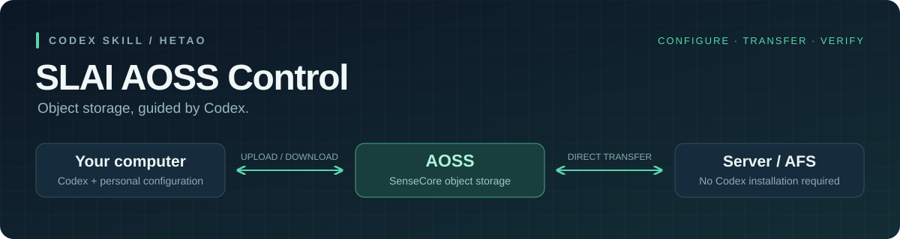

<p align="center">
  
</p>

<p align="center">
  <a href="slai-aoss/SKILL.md"></a>
  <a href="slai-aoss/requirements.txt"></a>
  <a href="LICENSE"></a>
</p>

<p align="center">
  面向河套学生，让 Codex 引导你使用商汤大装置平台的 AOSS。<br>
  从找到自己的连接信息，到文件传输、完整性校验与服务器取回。
</p>

<p align="center">
  <a href="#快速开始">快速开始</a> ·
  <a href="#你可以做什么">功能</a> ·
  <a href="#服务器无需安装-codex">服务器使用</a> ·
  <a href="#文档导航">文档</a>
</p>

## 快速开始

**把下面这段发给 Codex，其余步骤由它引导。**

```text
请安装并使用这个仓库中的 slai-aoss skill，引导我配置商汤大装置平台 AOSS：
https://github.com/ZhiChao-Chang/SLAI-AOSS_control/tree/main/slai-aoss
```

默认你已经有学校提供的平台账户和资源。Codex 会引导你找到自己的桶、endpoint 和 AccessKey，在本机终端录入凭据，并先做只读连接验证。

安装后若技能未被识别，再重新打开会话。需要手动安装时，见 [安装指南](docs/installation.md)。

## 你可以做什么

| 场景 | 交给 Codex 的一句话 |
| --- | --- |
| 查找文件 | `$slai-aoss 列出我桶里的 results/，最多20项。` |
| 上传文件 | `$slai-aoss 上传这个文件，保留已有同名对象。` |
| 下载与校验 | `$slai-aoss 下载这个对象，按我提供的 SHA-256 校验。` |
| 服务器取回 | `$slai-aoss 把数据下载到我指定的服务器目录。` |
| 数据集同步 | `$slai-aoss 规划目录增量同步，先预览，不删除数据。` |
| 临时分享 | `$slai-aoss 为这个对象生成一小时有效的私密下载链接。` |

普通文件使用 SDK 工具；大目录和增量同步按 ADS 指引执行。

## 服务器无需安装 Codex

Codex 可以在你的电脑上负责指导。服务器准备好工具、自己的凭据和可达的 endpoint，就能直接从 AOSS 下载到服务器目录或**已挂载的 AFS**，数据无需经个人电脑中转。

你可以自己在服务器终端执行命令，也可以在明确指定目标和操作后，由本地 Codex 通过已有 SSH 入口执行。

[查看服务器端完整流程 →](slai-aoss/references/server-download.md)

## 工作方式

**理解目标 → 读取个人配置 → 检查连接与目标状态 → 执行传输 → 校验并汇报**

- **自己的资源。** 从商汤大装置平台查找自己的桶和连接信息，不使用共享密钥。
- **凭据与仓库分离。** 在终端隐藏录入，默认存于个人 `~/.config/slai-aoss/`，不发到聊天。
- **默认防误覆盖。** 不自动删除对象、公开桶或启动计算资源。上传前存在性检查不构成并发写入锁。
- **清楚说明验证范围。** 字节数、SHA-256 元数据与独立内容校验分别报告；不将 multipart ETag 当作 SHA-256。

## 文档导航

| 文档 | 内容 |
| --- | --- |
| [安装指南](docs/installation.md) | Codex 安装、手动安装和更新 |
| [首次配置](slai-aoss/references/setup.md) | 查找桶、endpoint、AK/SK；安装工具并验证连接 |
| [文件操作](slai-aoss/references/operations.md) | 上传、下载、校验与临时链接 |
| [服务器与 AFS](slai-aoss/references/server-download.md) | 分清本地与远程步骤，直接下载到服务器 |
| [ADS 批量传输](slai-aoss/references/ads-cli.md) | 目录复制、增量同步及凭据使用限制 |
| [故障排查](slai-aoss/references/troubleshooting.md) | 网络、权限、签名与归档问题 |

## 验证与支持

已在 Linux 验证安装流程及 **15 项离线测试**，覆盖 SDK 配置、分页、防误覆盖、损坏下载拒绝发布和私密链接输出。Windows、macOS、WSL 提供使用指引；未宣称所有平台或真实账户均已实测。

工具需要 Python 3.10+。安装与账户连通是两件事，各自配置后需执行只读验证。[测试入口](slai-aoss/scripts/test_aoss.py) · [依赖版本](slai-aoss/requirements.txt) · [上游资料](slai-aoss/references/sources.md)

---

本项目为非官方学生工具，不代表 SLAI 或商汤官方产品。代码与文档采用 [MIT License](LICENSE)，依赖遵循各自许可证。
